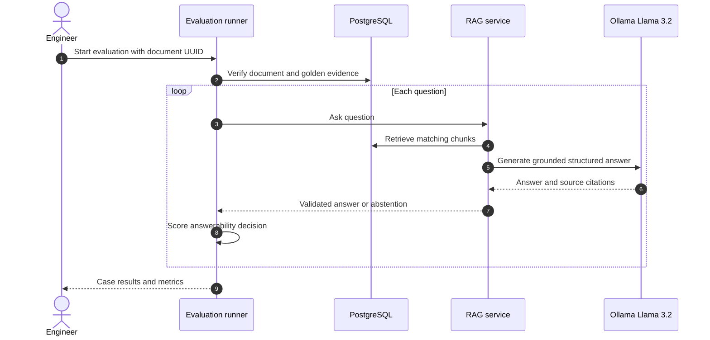
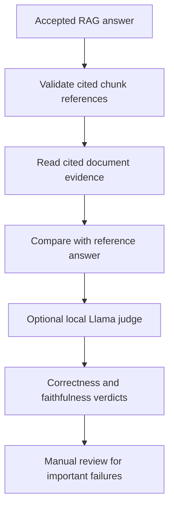
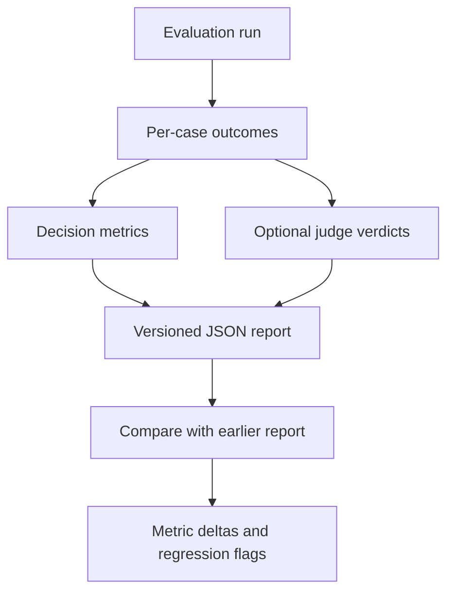

# Part 6 — RAG Evaluation Engineering

This guide documents the reproducible evaluation pipeline for the **Enterprise RAG** backend. It is a local engineering evaluation, **not a production accuracy guarantee**.

## 6.1: Golden dataset

`backend/evaluation/datasets/refund_policy.json` contains eight synthetic questions: five answerable, three unanswerable. The document file must have been uploaded with the matching original filename. The runner verifies that the expected evidence appears in stored chunks before scoring.

## 6.2: Retrieval metrics

`retrieval_metrics.py` defines Hit@K, Recall@K and MRR@K. Only answerable questions contribute to recall/ranking. Evaluate the negative cases separately.

## 6.3: Live retrieval evaluation

```bash
cd backend
uv run python -m evaluation.run_retrieval_eval --document-id YOUR_DOCUMENT_UUID --k 5
```

The initial one-chunk synthetic-policy dataset has minimal ranking difficulty. Its perfect retrieval scores do not establish retrieval quality at scale.

## 6.4: Live Llama generation evaluation



```bash
uv run python -m evaluation.run_generation_eval --document-id YOUR_DOCUMENT_UUID --skip-judge
```

`answer_document_question()` is invoked directly, using `SessionLocal` and `AIService`. The exact service-level abstention string distinguishes abstention from accepted answers. `context_found` must **not** be used as an answer-success indicator. Unexpected exceptions are recorded as **errors**, not as successful abstentions.

The decision metrics are answer coverage, abstention accuracy, unsupported-answer rate, and decision accuracy; they do not determine whether an accepted answer is factually correct.

## 6.5: Semantic correctness and claim faithfulness



Run with the local Llama judge (default):

```bash
uv run python -m evaluation.run_generation_eval --document-id YOUR_DOCUMENT_UUID
```

**Critical:** the judge is the same model family as the answer generator. Its verdicts are fallible and may be biased. `correct_rate_among_judged` and `faithful_rate_among_judged` cover only accepted, answerable responses that received a judge verdict. They are **not** a comprehensive correctness percentage over the dataset. Exact citation integrity is also not proof of entailment. Human review or a separately validated evaluator is necessary for any high-stakes claims.

## 6.6: Versioned reports and regression comparison



Reports are written to `backend/evaluation/reports/generation_eval_<timestamp>.json` (gitignored). The report contains question text and generated answers; use only synthetic, non-sensitive documents, or handle the output as sensitive data.

Example with a baseline from an earlier run:

```bash
uv run python -m evaluation.run_generation_eval \
  --document-id YOUR_DOCUMENT_UUID \
  --baseline evaluation/reports/PAST_REPORT.json
```

The comparison requires matching dataset, document ID, K, case IDs, judge setting and model identifiers and rejects runs containing execution errors. Regression flags are observations, not statistical significance tests.

## 6.7: Run tests and maintain documentation

```bash
uv run pytest tests/evaluation/ -v
uv run pytest tests/ -v
```

The new offline tests cover response classification, cited-chunk lookup, scoring, error accounting, baseline validation and JSON persistence. They do **not** need a running Llama server or PostgreSQL. Live results require both services, a matching `.env`, and the previously indexed synthetic refund-policy document.

### Known limitations and next improvements

- The golden dataset has eight cases drawn from one short document and cannot establish production generalization.
- The current system's citation validator checks quote integrity, not logical entailment.
- Llama-as-judge can misclassify policy reasoning; add human-reviewed verdicts and more challenging data.
- Current metrics are not confidence intervals; use more cases and repeated runs for stability.
- Authentication, tenant authorization and deployment hardening remain out of scope.
